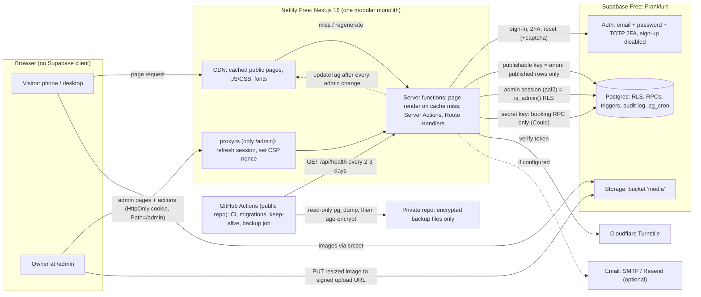
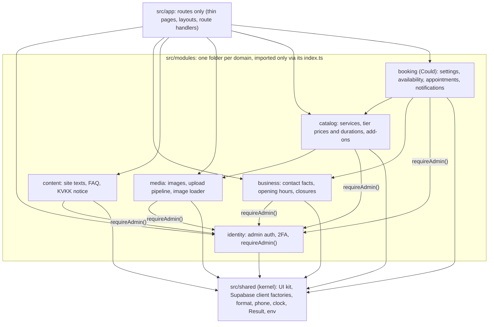

# Sniff Pet Kuaför — Implementation Plan (Phase A, revision 2)

> **Status:** approved 2026-11-11. This is a living document: when a decision changes, update it here and add or supersede an entry in [`decisions.md`](decisions.md). Requirements live in [`SPEC.md`](SPEC.md).

## Context

The repo is empty: it holds `docs/SPEC.md` and four images in `sources/images/` (three Instagram posts and the logo "coming soon" artwork), with no commits yet. We are building a Turkish public website, a phone-friendly `/admin` panel and, later, an appointment-request system for a cat and dog grooming shop in Gölbaşı, Ankara. It must run at €0/month and doubles as your portfolio piece.

This plan covers the eight items SPEC §0 asks for (sections 1–8). It adds a **security threat model** (§9) and **Git conventions** (§10).

### What changed from revision 1 (your feedback)

- **Domain modules:** the code is a **modular monolith split by domain**, not by layer. SOLID is applied where it pays off (§1.3).
- **Priorities:** **M0–M4 is the MVP (Must).** Booking and appointments move to **M5–M6 (Could)**.
- **Docker:** a **local Supabase stack in Docker** is the default dev database, so every branch runs the full test suite locally and in CI.
- **2FA required for every admin.** The database itself refuses admin writes without it.
- **Security reconsidered** as a threat model, with a test for each mitigation.
- **Testing on every branch:** E2E and accessibility tests start in M0 instead of at the end.
- **Booking safety:** four layers of checks, not only the database constraint (§4).
- **Decision records:** all go in a single `docs/decisions.md` in standard ADR format.
- **Palette:** muted text darkened for readability, one caramel accent added, one error colour (§1.5).
- **Logo:** an interim transparent logo is extracted from `logo_+_coming_soon.png`. The three Instagram posts stay demo-only.
- **Git:** history rewriting is allowed on my own feature branches, explained each time (§10). The co-author line stays; the licence is still to be decided.
- **Unexpected closures:** the owner can close the shop for a full or partial day in two taps. The site immediately shows a notice and stops offering those times. *(Could)* Existing bookings in that window are listed for bulk cancellation and customer notification (§4.1).

Hosting and free-tier facts were checked in November 2026 (sources at the end). Items marked **verify** get confirmed in M0.

### On approval, in this order (SPEC §0 says to update the spec first when a requirement changes)

1. Update `docs/SPEC.md` for the changes you approved:
   - Git rules (§0)
   - Docker (§0)
   - Palette (§6)
   - Mandatory 2FA (§14)
   - `docs/decisions.md` instead of `docs/decisions/` (§17)
   - MoSCoW milestone priorities (§17)
2. Save this plan as `docs/PLAN.md`.
3. Write `docs/decisions.md` (ADR-001 to ADR-017; see the table below and §10).
4. Write `CLAUDE.md`: conventions, module rules, folder layout, commands.
5. Make the initial commit on `main`, then open branch `chore/m0-setup`.

---

## Key decisions (each becomes an ADR in `docs/decisions.md`, dated 2026-11-11)

| ADR | Decision | Why, in short |
|---|---|---|
| 001 | **Modular monolith, partitioned by domain** (identity, business, content, media, catalog, booking), with module boundaries enforced by ESLint | One deployable app (free hosting, simple ops) whose internal structure follows the business, not technical layers |
| 002 | **Next.js 16 (App Router) + React 19 + TS strict + Tailwind v4**, Node 24 LTS | Current stable versions |
| 003 | **Netlify Free for production *and* previews**; production branch `production`; day-to-day work merges into `main` | Commercial use allowed, previews and branch deploys use no credits, and only releases cost credits (§5) |
| 004 | **Local Supabase in Docker for dev and tests**; the cloud dev project serves Netlify previews; a separate prod project | Tests on every branch, data resets in seconds, nothing touches shared data |
| 005 | **Supabase's new API keys** (`sb_publishable_…` / `sb_secret_…`); three server-side client roles; **no Supabase client in the browser** | The legacy keys are deprecated by the end of 2026. Without a browser client the session cookie can be HttpOnly (§9). |
| 006 | **Admin sessions hardened:** HttpOnly + Secure + SameSite=Lax cookies **scoped to `/admin`**; **TOTP 2FA required (`aal2`)**; Turnstile on login and password reset | Stolen passwords and XSS are the realistic threats to a small business site (§9) |
| 007 | **Double booking prevented in four layers**, with a Postgres exclusion constraint over "lanes" as the final guarantee (Could) | Safety even if application code has a bug (§4) |
| 008 | **Images:** the browser makes 480/960/1600 px WebP (JPEG fallback) and uploads through **signed upload URLs**; a custom `next/image` loader picks the size; no optimisation service | Free and host-agnostic; saves Netlify credits; strips GPS metadata |
| 009 | **One public Storage bucket with unguessable paths and no listing** (a deviation from SPEC §16 "published-only reads"; veto at approval if you disagree) | Strict reads need expiring signed URLs, which break CDN caching. Unpublished images can't be found or listed. |
| 010 | **Housekeeping in `pg_cron` inside Supabase.** GitHub Actions only for external jobs (keep-alive, backup, migrations). | Host-agnostic, fewer moving parts |
| 011 | **Postgres-based rate limiting** (no Redis/KV) | Host-agnostic, enough for the traffic |
| 012 | **KVKK notice as versioned Markdown in the repo**; the acknowledged version is stored with each booking | Legal text changes through review + deploy, and git history is the version log |
| 013 | **Native `<details>` / `<dialog>` and our own small UI kit**; only `lucide-react` for icons | Fewer dependencies, accessible by default, readable code |
| 014 | **Palette:** `muted-text` → `#66625E`, a caramel accent, a brick red for errors | Readability standard (WCAG AA) plus your request for a modern third colour (§1.5) |
| 015 | **Custom SMTP for Supabase Auth emails:** a Gmail app password until the domain exists, then Resend | The built-in sender sends 2 emails/hour and, on new free projects, can't be customised, so emails would arrive in English |
| 016 | **Backups:** a daily `pg_dump` encrypted with `age`, committed to a private repo by a workflow that lives in the public repo | No public backup files; the workflow stays visible in your portfolio |
| 018 | **Caching model: Next.js Cache Components** (`'use cache'` + `cacheTag`; admin actions call `updateTag`). *Proposed* until verified on Netlify at the start of M2. | The default and documented model in Next.js 16.4. Fallback: the previous `revalidatePath` model (added during M0) |

---

## 1. Architecture overview

### 1.1 Runtime: what runs where



| Where | What |
|---|---|
| **Browser** | Static HTML plus small interactive islands (menu, lightbox, admin forms, later the booking wizard). In admin, images are resized on a canvas and sent with a plain `fetch PUT` to a one-time signed upload URL. **No Supabase SDK and no session token is ever readable by JavaScript.** |
| **Netlify CDN** | Pre-rendered public pages, regenerated on demand after admin changes |
| **Netlify functions** | Server Components on a cache miss; Server Actions (all admin changes; later booking); Route Handlers (`/api/health`, CSV export later, `/admin/auth/confirm`); `proxy.ts` on `/admin/*` only, so public pages stay static and cheap |
| **Supabase** | Postgres (data, RLS, functions, audit trail, `pg_cron`), Auth (admins, 2FA), Storage (images, year-long cache) |
| **GitHub Actions** | CI on every PR; migrations to the dev/prod projects; keep-alive; nightly encrypted backup into the private repo |

### 1.2 Environments

| Environment | App | Database | Data |
|---|---|---|---|
| Local | `npm run dev` | Supabase in Docker (`npm run db:start`) | Seed + test data, reset with `npm run db:reset` |
| CI | Production build on the runner | Supabase in Docker on the runner | Fresh every run |
| PR previews + `main` branch deploy | Netlify, no credits used | **dev** Supabase project (cloud) | Demo data only |
| Production | Netlify, `production` branch | **prod** Supabase project (Frankfurt) | Real data |

Migrations are written locally and tested with `db:reset` plus the tests. Once merged, a workflow applies them to the dev project (push to `main`) or the prod project (push to `production`, environment-protected). Every migration is additive (expand/contract), so a deploy and its migration may land in either order.

### 1.3 Modular monolith: domain modules



**Rules, enforced by `eslint-plugin-boundaries` in CI:**

- `app` may import any module's `index.ts` and `shared`.
- A module may import `shared` and the `index.ts` of modules it is allowed to depend on (arrows above). Deep imports into another module's internals fail lint.
- `shared` imports nothing from modules. No cycles.
- Each module **owns its tables** and ships its own migrations and seed files (`20261112…_catalog_services.sql`). Cross-module foreign keys point only "down" the graph (e.g. `catalog.services.image_id → media`).

Java analogy: each module is a package-by-feature whose `index.ts` is its public interface. Everything else is effectively package-private.

**Inside a module** (kept small; no empty folders "for later"):

```
src/modules/catalog/
  index.ts      public API: queries, actions, UI components, types
  domain/       pure rules and types, no I/O (e.g. price-display.ts, tier rules)
  data/         repository: Supabase queries (the only place SQL/PostgREST is touched)
  actions.ts    Server Actions = use cases: requireAdmin → Zod parse → repo → revalidate
  schemas.ts    Zod schemas shared by client and server
  ui/           public + admin components for this domain
  *.test.ts     next to the code they test
```

**SOLID, applied where it earns its keep:**

| Principle | How it shows up | Example |
|---|---|---|
| **S**ingle responsibility | Each file has one reason to change: route = composition, `domain/` = rules, `data/` = queries, `actions.ts` = orchestration | `price-display.ts` changes only if price wording rules change |
| **O**pen/closed | Extend by adding an entry or an implementation, not by editing a switch spread through the code | `priceFormatters: Record<PriceType, …>`; booking `Notifier` implementations (WhatsApp link, email) |
| **L**iskov substitution | Interchangeable implementations pass the same contract tests | `EmailSender`: `SmtpEmailSender` and `NoopEmailSender` (when email isn't configured) |
| **I**nterface segregation | Narrow interfaces | The availability engine receives `ScheduleRules` and `BusyRanges`, not a whole repository |
| **D**ependency inversion | Use cases depend on interfaces; real adapters (Supabase, SMTP, Turnstile, clock) are wired in each module's `index.ts` with plain factory functions, without a DI framework | `createBookingService({ repo, captcha, rateLimiter, clock, notifier })`; tests pass in-memory fakes |

**Proportionality:** interfaces exist only at real seams: database calls inside logic-heavy code, the clock, captcha, email and the rate limiter. A simple CRUD module like the FAQ is schema + repository + action, with no extra layers.

### 1.4 Server-side Supabase clients

These live in `src/shared/supabase/`. Java analogy: three DataSources with different DB users.

| Factory | Identity | Used by | Safety net |
|---|---|---|---|
| `publicClient()` | Publishable key, no cookies = `anon` | All public pages | RLS returns published rows only. Reading no cookies keeps pages static and cacheable. |
| `adminClient()` | Publishable key + the admin's HttpOnly session cookie | Admin pages and actions | RLS requires `is_admin()`, meaning listed in `private.admins` **and** a JWT with `aal = aal2` (2FA done) |
| `serviceClient()` | Secret key, inside an `import 'server-only'` module | Booking RPC and busy-slot read (Could). Added when first needed (M5); scripts and tests create their own client, because `server-only` can't load outside Next.js | Never bundled for the browser; a CI step also greps the client build for `sb_secret_` |

### 1.5 Brand palette (Tailwind v4 `@theme`; Tailwind's default colours are removed, so only these exist)

| Token | Hex | Use |
|---|---|---|
| `navy` | `#07152B` | Text, buttons, navigation |
| `cream` | `#F5E1CE` | Hero and section backgrounds, decorative shapes |
| `white` | `#FFFFFF` | Cards, forms |
| `beige` | `#E9D8C6` | Secondary warm accents |
| `neutral-bg` | `#FAF6F1` | Page background |
| `muted-text` | **`#66625E`** (was `#77736F`) | Secondary text. The original grey was too light to read comfortably on cream: contrast 3.7:1, where the accessibility standard asks for 4.5:1. The new one looks almost identical and passes: cream 4.8, page 5.6, white 6.1. Not used on beige. |
| `caramel` (new accent) | **`#C98A4B`** | Small highlights: badges, paw accents, decorative shapes, active underlines. Warm like the cream and the dog fur in the Instagram posts, and the complement of navy, which makes the palette feel fresher and more modern. Text on caramel is always navy (6.3:1). It is **never** used as a text colour on light backgrounds. |
| `danger` | **`#A63D2A`** | Error messages and "Sil" buttons only (≥ 4.5:1 on every light background). Success messages use navy plus a ✓ icon, so no green is needed. |

The logo itself is never recoloured. Its PNG navy samples as `#152543`; I'll re-check the `navy` token against the real logo file when it arrives.

**Logo (interim):** I'll crop the wordmark and "PET KUAFÖR" from `sources/images/logo_+_coming_soon.png` and turn the background transparent based on pixel darkness. That keeps the original edges and colour: no redrawing, recolouring or vectorising. It becomes `public/brand/logo-interim.png` until you send the real file.

---

## 2. Database design

**Extensions:**
- `pg_cron` for scheduled housekeeping.
- `btree_gist` (Could) for the booking exclusion constraint.

The GraphQL endpoint is **disabled** because it's unused.

**Schemas:**
- `public` holds tables the API may expose, always behind RLS.
- `private` is **not exposed** through the API: admins, audit log, rate limits.

### Enums (English in code; Turkish labels in one `labels.ts` per module)

| Enum | Values | Module |
|---|---|---|
| `pet_type` | `cat`, `dog` | shared |
| `pet_scope` | `cat`, `dog`, `both` | catalog |
| `service_category` | `cat_care` (Kedi Bakımı), `dog_care` (Köpek Bakımı), `general` (Genel Bakım) | catalog |
| `price_tier` | `cat`, `dog_small`, `dog_medium`, `dog_large` | catalog |
| `price_type` | `fixed`, `starting_from`, `contact` | catalog |
| `media_kind` | `hero`, `gallery`, `instagram`, `about`, `service` | media |
| `appointment_status` (Could) | `pending`, `confirmed`, `rejected`, `cancelled`, `completed`, `no_show` | booking |
| `appointment_source` (Could) | `website`, `phone`, `whatsapp`, `instagram`, `walk_in`, `other` | booking |
| `dog_size` (Could) | `small`, `medium`, `large` | booking |

### Common columns and triggers

- **Every editable table:** `id uuid PK`, `created_at`, `updated_at`, `updated_by → auth.users`. The last two are set by triggers.
- **Content tables** also have `sort_order`, `is_published` (default false) and `is_demo` (default false).
- **Publish trigger:** publishing a row clears `is_demo`. The admin UI first asks "Bu içerik örnek olarak eklendi. Bilgileri kontrol ettiniz mi?".
- **Audit trigger** on every content table writes to `private.audit_log`: table, row id, action, actor, time, and old/new values as `jsonb`.
  - Lets us see who changed what and restore a mistaken deletion.
  - Purged after 180 days.
  - Appointments (Could) log status and time fields only, never personal data.

### Tables: MVP

| Module | Table | Key columns | Constraints / notes |
|---|---|---|---|
| identity | `private.admins` | `user_id PK → auth.users`, `display_name` | Rows added by SQL only (owner + developer) |
| business | `business_profile` (1 row) | `business_name`, `slogan`, `address`, `maps_url`, `map_embed_url?`, `instagram_url`, `phone_e164?`, `whatsapp_e164?`, `email?` | Single row (`id boolean PK check (id)`). Phone matches `^\+90\d{10}$`. Seeded from SPEC §5; phone, WhatsApp and email start empty. |
| business | `opening_hours` | `weekday 1–7` (ISO, 1 = Pazartesi), `opens_at`, `closes_at` | `closes_at > opens_at`. No overlapping intervals per day (exclusion constraint over `weekday` and a `tsrange` built on a fixed dummy date). Several rows per day = breaks. Starts **empty**; shown publicly and in JSON-LD only once entered. |
| business | `closures` | `starts_at timestamptz`, `ends_at timestamptz`, `public_note?`, `internal_note?` | `ends_at > starts_at` (half-open range). Covers **whole days** (the UI stores 00:00–24:00 Istanbul time) **or part of a day** (e.g. "bugün 14:00'ten itibaren"). `public_note` is shown in a site-wide banner while the closure is upcoming (within 7 days) or active. |
| content | `site_texts` (1 row) | `hero_title`, `hero_subtitle`, `hero_text`, `welcome_text`, `about_markdown` | Seeded with the SPEC §8 texts |
| content | `faq_items` | `question`, `answer` + content columns | Seeded drafts with placeholder answers |
| media | `media` | `kind`, `storage_prefix`, `file_ext` (`webp`/`jpg`), `widths int[]`, `width`, `height`, `alt_text`, `caption?`, `category pet_type?`, `credit?` + content columns | `alt_text` can't be blank. Demo stock images may be shown as decoration but stay flagged. |
| catalog | `services` | `name`, `description`, `category`, `pet_scope`, `image_id → media?` + content columns | 6 seeded drafts (`is_demo`, unpublished) |
| catalog | `service_prices` | `service_id → services (cascade)`, `tier`, `price_type`, `amount numeric(10,2)?`, `duration_min?`, `is_demo` | `id` PK like every table, plus unique `(service_id, tier)`. Amount required unless `contact` (and absent for `contact`); amount ≥ 0; duration > 0. No row = tier not offered. Seeded rows are "DEMO / OWNER APPROVAL REQUIRED" and the owner confirms them per service ("Fiyat ve süreleri onaylıyorum"). |
| catalog | `addons` | `name`, `description`, `pet_scope`, `price_type`, `amount?`, `duration_min default 0` + content columns | One price per add-on (A6) |
| (all) | `private.audit_log` | `table_name`, `row_id`, `action`, `actor`, `at`, `old jsonb`, `new jsonb` | Written by trigger, read via the dashboard |

**Indexes:** content tables hold dozens of rows, so primary keys suffice. The one index added is `audit_log (table_name, row_id, at)`.

### Tables: booking module (Could, M5–M6)

These ship with the booking module's own migrations, not in the MVP.

- **`booking_settings` (1 row):**
  - `booking_enabled = false`
  - `slot_interval_min ∈ {10, 15, 20, 30, 60}`, `buffer_min 0–240`, `capacity 1–10`
  - `min_notice_min`, `max_days_ahead`, `pending_expiry_hours?`, `retention_months?`
  - `notification_email?`, hidden from anon by a column-level grant
- **`appointments`:**
  - Identity: `reference_code` (unique, `SP-` + 6 digits), `status`, `source`, `lane`
  - Time: `starts_at`, `ends_at`, `blocked_until` (= end + buffer), `expires_at?`
  - Cancellation: `cancel_reason?` (enum `customer`, `business`, `business_closed`, `expired`), `cancel_note?`
  - Pet: name, breed, `dog_size` (required exactly for dogs), weight, care requests, special notes
  - Customer: name, phone (E.164), email, notes
  - Snapshot: service name, tier, price type and amount, duration, add-ons as `jsonb`, buffer
  - Privacy: `kvkk_version`, `kvkk_acknowledged_at`, `anonymized_at`
  - Admin: `internal_notes`
- **The constraint:** `EXCLUDE USING gist (lane WITH =, tstzrange(starts_at, blocked_until, '[)') WITH &&) WHERE (status IN ('pending', 'confirmed'))`
- **Indexes:** the constraint's GiST index; `(status, starts_at)`; partial index on `customer_phone_e164 WHERE status = 'pending'`.
- **`private.rate_limits`:** `(key, window_start, hits)`.

### Database functions

**Function rules:**
- `EXECUTE` is revoked from `public` and `anon` by default and granted one function at a time.
- `SECURITY DEFINER` functions set `search_path = ''`.

| Function | Caller | Purpose |
|---|---|---|
| `private.is_admin()` | used inside policies (EXECUTE for `authenticated` only) | `auth.uid()` is in `private.admins` **and** `auth.jwt()->>'aal' = 'aal2'` |
| `public.health_check()` | anon, via `/api/health` | Returns `true`: one tiny query that touches no domain table |
| `set_updated_meta()`, `clear_demo_on_publish()`, `write_audit()` | triggers | Common columns, publishing, audit trail |
| `purge_audit_log()` | `pg_cron`, weekly | Retention |
| *(Could)* `create_booking_request(jsonb)` | service_role only | One transaction with the full rule re-check and lane insert (§4) |
| *(Could)* `admin_create_appointment`, `reschedule_appointment` | admins (security invoker, so RLS applies) | Same lane logic; may skip hours rules, never the overlap rule |
| *(Could)* `expire_due_pending()`, `anonymize_old_appointments()`, `get_busy_ranges()`, `hit_rate_limit()` | cron / service_role | Housekeeping and availability |

### Row Level Security (enabled on every table; a pgTAP test fails CI otherwise)

| Table | anon (public site) | authenticated, not admin | admin (`is_admin()`, so 2FA done) |
|---|---|---|---|
| `services`, `addons`, `faq_items`, `media` | SELECT where `is_published` | none | all |
| `service_prices` | SELECT where `NOT is_demo` and the parent service is published | none | all |
| `business_profile`, `site_texts`, `opening_hours`, `closures` | SELECT (`closures` without `internal_note`, by column grant) | none | all (profile and texts: SELECT/UPDATE only, they are single rows) |
| `private.*` | not reachable through the API | not reachable | via functions or the dashboard only |

*Changed in M1:* "authenticated, not admin" gets **nothing** instead of the anon view. The public site only ever uses the anon role, and the only signed-in users are admins, so a password-only (aal1) session simply sees no rows. This is simpler and stricter. Table grants are explicit as well: anon has SELECT only, so even a missing policy could never let a visitor write.
| *(Could)* `booking_settings` | SELECT on every column except `notification_email` | same as anon | all |
| *(Could)* `appointments` | **none** | none | all; website inserts only through the RPC |

### Storage

| Bucket | Read | Limits | Policies on `storage.objects` |
|---|---|---|---|
| `media` | Public by exact URL | 2 MB per object; `image/webp`, `image/jpeg` only (no SVG) | INSERT (needed to create signed upload URLs), SELECT and DELETE only when `is_admin()`. anon has no SELECT policy, so **the bucket can't be listed**. |

- **Upload flow:**
  1. The `media` action `createUploadTargets()` runs `requireAdmin()` and returns signed URLs for `<kind>/<uuid>/<width>.<ext>`.
  2. The browser PUTs each variant.
  3. `registerMedia()` checks the objects exist and inserts the row.
- **Caching:** year-long immutable cache headers. Replacing an image creates a new path.
- **Deleting:** removes the row, then every variant file. A failure is reported to the owner, not swallowed.

---

## 3. Route map

### Public (`src/app/(site)/`: shared header and footer; pages are static with on-demand revalidation plus a 1-hour fallback)

| URL | Page | Modules used |
|---|---|---|
| `/` | Anasayfa: hero, welcome, services, why us, steps, gallery, Instagram, location, CTA | content, media, catalog, business |
| `/hizmetlerimiz` | Services grouped by category, or the §9 fallback text | catalog, media |
| `/fiyatlarimiz` | Tier price table + add-ons, or the §10 fallback + "Fiyat Bilgisi Al" (WhatsApp if set, otherwise `/iletisim`) | catalog, business |
| `/hakkimizda` | About text (Markdown, no HTML) + optional image | content, media |
| `/galeri` | Grid + `<dialog>` lightbox, Kedi/Köpek filter | media |
| `/sss` | `<details>` accordion | content |
| `/iletisim` | Address, lazy-loaded map, phone, WhatsApp, Instagram, opening hours (once entered), "Yol Tarifi Al" | business |
| `/randevu-al` | **MVP:** friendly "online randevu yakında" message with phone, WhatsApp and Instagram. **Could (M5):** the booking wizard (`?hizmet=<id>`) | business (+ booking) |
| `/kvkk` | Draft Aydınlatma Metni, clearly marked | content |
| `not-found.tsx` | Turkish 404 | — |
| *(every page)* | Closure banner, e.g. "12 Aralık Perşembe günü kapalıyız. …", shown while a closure with a public note is upcoming or active | business |
| `/sitemap.xml`, `/robots.txt` | `/admin` disallowed; previews get `noindex` | — |

Public data functions are cached with `'use cache'` + `cacheTag('<module>')` + `cacheLife('max')`, and each admin action calls `updateTag('<module>')` for the data it changed (ADR-018, added during M0). If Netlify fails the M2 verification gate, we fall back to `revalidatePath('/', 'layout')`.

### Admin (`src/app/admin/`: everything `noindex`, a strict nonce-based CSP, Turkish ASCII slugs)

| URL | Page | Module |
|---|---|---|
| `/admin/giris` | Sign in (Turnstile) | identity |
| `/admin/dogrulama` | Enter the 6-digit 2FA code | identity |
| `/admin/dogrulama-kurulumu` | First login: scan the QR code to enrol 2FA (mandatory) | identity |
| `/admin/sifremi-unuttum`, `/admin/sifre-yenile` | Forgot password (same message whether or not the email exists), set a new password | identity |
| `/admin/auth/confirm` | Route handler: verifies the email-link token and sets the cookie (under `/admin`, matching the cookie path) | identity |
| `/admin` | Panel: **"Acil kapanış" quick action** (today / pick a date / from a time), "eksik bilgiler" checklist, quick links (later: pending count, today) | all |
| `/admin/isletme-bilgileri` | Contact, address, map, Instagram | business |
| `/admin/calisma-saatleri` | Opening hours (several intervals per day), closures (later: booking settings) | business (+ booking) |
| `/admin/metinler` | Hero, welcome and About texts | content |
| `/admin/hizmetler` (+ `/yeni`, `/[id]`, `/ek-hizmetler`) | Services, per-tier price/type/duration, DEMO badge, confirm prices, add-ons, ↑/↓, publish | catalog |
| `/admin/galeri?tur=gallery\|instagram\|hero\|about` | Image upload, alt text, caption, order, publish, delete | media |
| `/admin/sss` | FAQ | content |
| `/admin/hesap` | Change password, 2FA status, sign out | identity |
| *(Could)* `/admin/randevular` (+ `/yeni`, `/[id]`, `/csv`) | Appointments, manual entries, CSV export | booking |

**Guards:**
- `proxy.ts` refreshes the session and sets the CSP nonce.
- `(panel)/layout.tsx` runs `requireAdmin()` and redirects to sign-in or the 2FA step.
- **Every Server Action runs `requireAdmin()` again**, because actions are public HTTP endpoints.
- RLS repeats the same check inside the database.

**Other:** `/api/health` is dynamic, does one tiny DB read and returns `{"ok":true}` or 503, with no data in the response.

### Folder layout (goes into CLAUDE.md)

```
src/app/(site)/…  src/app/admin/…  src/app/api/health/  src/proxy.ts
src/modules/{identity,business,content,media,catalog,booking}/   (index.ts = public API)
src/shared/{ui,supabase,lib}/        UI kit · client factories · format/phone/clock/Result/env
supabase/migrations/  supabase/seed/  supabase/tests/ (pgTAP)
content/kvkk.md   scripts/ (seed-media, extract-logo)   tests/e2e/ (Playwright + axe)
docs/ SPEC · PLAN · decisions.md · YONETICI_REHBERI · IMAGE_CREDITS
.github/workflows/ ci · codeql · migrate · keep-alive · backup     .github/dependabot.yml
```

---

## 4. Availability and booking algorithm (Could: M5–M6, designed now so the MVP doesn't block it)

**Inputs** (all editable, none invented):
- From `business`: opening intervals and closures.
- From `booking_settings`: slot interval, buffer, capacity, minimum notice, maximum days ahead.
- Duration: the verified `service_prices.duration_min` for (service, tier) plus the add-ons' minutes.
- Busy ranges from the database.
- Timezone is always `Europe/Istanbul` (`@date-fns/tz`); `+03:00` is never hard-coded.

**Slot engine:** a pure function in `booking/domain`, `computeAvailability(rules, busy, duration, now) → { "2026-12-01": ["09:00", …] }`.

1. For each date from today to today + max days, take that weekday's opening intervals.
2. In each interval, candidate starts are every slot interval from the opening time, as long as `start + duration ≤ close`. The buffer may run past closing.
3. Drop candidates whose service time overlaps **any closure**, full-day or partial. Drop candidates earlier than `now + minimum notice`.
4. A candidate occupies `[start, start + duration + buffer)`. It is free if **some lane `1…capacity` has no overlapping busy range**.
5. Return only dates with at least one free slot. The calendar shows only those days.

**Lanes:** think of a lane as a grooming table. Each booking takes one lane, and Postgres refuses overlaps within the same lane. This works for any capacity without table locks. The engine uses the same lane rule, so it never offers a slot the database would refuse. Later a lane can become a staff member. Trade-off: slight fragmentation, at most one slot fewer than perfect packing.

### Four layers of protection against double booking

You asked for functional checks as well as the database constraint.

| Layer | Where | What it checks |
|---|---|---|
| 1. UI | Booking wizard | Shows only free slots from a fresh availability call |
| 2. Application | Server Action, using the TS engine | Zod, Turnstile, rate limit; recomputes that day's slots from fresh data and rejects a start that is no longer offered |
| 3. Database rules | `create_booking_request`, inside the transaction | **A second, independent implementation of the business rules in SQL:** booking open, service published, tier duration verified, inside an opening interval and ending by close, not overlapping any closure, minimum notice, maximum days ahead. The duration and price snapshot are read from the DB; client values are never trusted. |
| 4. Database invariant | Exclusion constraint | Two active bookings can **never** overlap in a lane, whichever code path inserts them (customer, admin, a future bug). If two requests race, the second waits for the first to commit, then fails → `slot_taken` → "Seçtiğiniz saat az önce doldu" with fresh times. |

Layers 2 and 3 are deliberately separate implementations. **Differential tests** feed one shared table of scenarios to both the TS engine (Vitest) and the SQL function (integration test) and require identical answers. If either has a bug, the tests catch it.

### 4.1 Unexpected closure (illness, emergency, power cut…)

| Step | What happens |
|---|---|
| 1. Owner taps **"Acil kapanış"** on the panel | Picks "Bugün", a date, a date range, or "bugün HH:MM'den itibaren", and optionally writes a public note. This creates a `closures` row. **MVP:** the site banner appears within seconds. |
| 2. New bookings stop immediately *(Could)* | Availability excludes the closed window. Anyone mid-booking is stopped by layers 2 and 3 below, since the closure is re-checked at submit. To stop *all* online booking at once, the owner flips `booking_enabled` off. |
| 3. Existing bookings are **not** silently cancelled *(Could)* | The confirmation screen says "Bu kapanış 3 randevuyu etkiliyor" and lists them, with **"Hepsini iptal et"**. That sets them to `cancelled`, `cancel_reason = business_closed` and frees the slots. |
| 4. Customers are told *(Could)* | Each affected booking gets a **"WhatsApp'tan Bildir"** button with a prefilled apology and an invitation to pick a new time, plus "Ara". If email is configured, emails go out automatically. Limitation: free `wa.me` links can't send in bulk, so it is one tap per customer. The list shows who has already been notified. |

The owner can delete or shorten a closure; those times become bookable again at once. The owner's guide gets a short "Acil kapanış" section.

**Pending requests hold their slot** (they're inside the constraint's `WHERE`). Rejecting, cancelling or auto-expiring frees the slot at once. `expire_due_pending()` runs every 10 minutes and again at the start of each booking transaction. No text, email or WhatsApp message ever calls a pending request confirmed; template tests enforce this.

**Tests:**
- **Engine:** interval edges, lunch break, slot interval, duration longer than an interval, buffer past closing, capacity 1 and 2, lane fragmentation, closures, minimum notice, maximum days ahead, UTC server versus Istanbul dates around midnight, a DST zone.
- **Integration:** 10 concurrent requests for one slot → exactly `capacity` succeed.

---

## 5. Production hosting recommendation

| | **Netlify Free** | Cloudflare Workers Free + OpenNext | Vercel Hobby |
|---|---|---|---|
| Commercial use | Allowed according to the sources (**verify** the terms in M0) | Allowed | **No** (non-commercial only) |
| Next.js 16 | Official adapter: App Router, proxy/middleware, ISR + on-demand revalidation | Supported, but **Node middleware (Next 16 `proxy`) isn't yet**; extra cache setup | Native |
| Free limits | **300 credits/month, hard cap.** Production deploy 15, bandwidth 20/GB, compute 10/GB-hour, requests 2 per 10k. **Previews and branch deploys are free.** | 100k requests/day; **10 ms CPU per request**; 3 MiB compressed Worker (OpenNext's docs; Cloudflare's own page says 64 MiB uncompressed) | n/a |
| When exceeded | All projects **pause** until next month. No bill. | Errors 1102 / 1027 | n/a |

**Recommendation: Netlify Free.** It allows commercial use, runs current Next.js natively, revalidation works on demand, the `/admin` proxy works, and previews are free.

- **Why not Cloudflare:** its 10 ms CPU cap is the deal-breaker. Real reports show OpenNext routes using 60–120 ms of CPU, so rendering and actions would fail at random. The missing proxy support is a second blocker.
- **Vercel** is ruled out by its terms.

**Budget estimate:**

| Item | Credits |
|---|---|
| 4 releases/month × 15 | 60 |
| ~3,000 visits × ~0.4 MB of HTML/JS/CSS (images come from Supabase) | ~24 |
| ~45k requests | ~9 |
| Compute (< 2 GB-hours) | ~20 |
| **Total** | **~115 / 300** |

**Fallback:** Netlify Personal ($9/month). No Netlify-specific APIs are used, so moving hosts stays possible.

**Region:** Supabase in Frankfurt. *Verified in M0:* on Free, Netlify functions always run in Ohio (us-east-2); choosing a region needs an upgrade. Visitors are unaffected (public pages come from the CDN); uncached admin requests pay ~100 ms per database round trip, kept low by running independent queries in parallel. Supabase stays in the EU for KVKK (ADR-003).

**Until you buy the domain:** production runs at `<site>.netlify.app`. Turnstile's hostname is set to it, and auth emails use the interim Gmail SMTP (ADR-015).

---

## 6. Milestones (MoSCoW: **M0–M4 = Must, the MVP launch**; **M5–M6 = Could, booking**)

**How every branch is tested:**

| Level | Tool | What | Runs |
|---|---|---|---|
| Static | ESLint (+ module boundaries), `tsc` strict, Prettier | Types, style, no deep cross-module imports | Locally (`npm run verify`) + CI |
| Unit | Vitest | Domain rules, Zod schemas, formatters (₺, dates, Turkish suffix), phone, CSV escaping, (Could) slot engine | Locally + CI |
| Integration | Vitest + local Supabase (Docker) | Repositories, **every Server Action called without a session must be rejected**, upload limits, (Could) RPCs and concurrency | Locally + CI |
| Database | pgTAP (`supabase test db`) | RLS per role (anon / authenticated / admin without 2FA / admin with 2FA), constraints, triggers, grants, "RLS on for every table" | Locally + CI |
| E2E + a11y | Playwright + `@axe-core/playwright` | User journeys of the milestone, an axe scan of every page, security headers present | Locally + CI, **from M0 on** |
| Performance | Lighthouse CI (score budget ≥ 0.9) | `/`, `/hizmetlerimiz`, `/galeri`, `/randevu-al` on a production build | CI from M2 |
| Security | CodeQL, `npm audit --audit-level=high`, Dependabot, secret-in-bundle grep; ZAP baseline scan before launch | | CI / M4 |
| Manual | The milestone checklist on the deploy preview, **on a real phone** | | Every PR |

- **Coverage:** ≥ 90% lines on `modules/*/domain/**` and `shared/lib/**`. No global threshold, because UI coverage numbers would be vanity.
- **Definition of Done for each PR:** CI green; new logic has tests; preview checked on a phone; `PLAN.md`, `decisions.md`, README and the owner's guide updated where affected; additive migrations only.
- **Branch protection** on `main` and `production`: PR required, CI must pass, no force-push.

### M0 — Setup (Must)

- **Build:**
  - Next 16 + TS strict + Tailwind v4 tokens (§1.5) + `next/font` (Nunito Sans / DM Sans, `latin-ext`)
  - ESLint, Prettier, Vitest, Playwright + axe smoke test (module-boundary lint rules arrive in M1 with the first modules)
  - Supabase CLI as a dev dependency; `supabase init`; `npm run db:start / db:stop / db:reset / db:types`
  - Interim logo extraction script
  - Turkish "Çok Yakında" page in the style of the coming-soon artwork; `<html lang="tr">`
  - `/api/health`; baseline security headers in `next.config` (host-agnostic); `poweredByHeader: false`
  - CI, CodeQL and Dependabot (npm + actions), with actions pinned to commit SHAs and read-only `permissions`
  - Netlify config: production branch `production`; previews `noindex`
  - `CLAUDE.md`, `PLAN.md`, `decisions.md`, README skeleton
- **You do:** install Docker Desktop; create the dev Supabase project (Frankfurt); create the Netlify site from the repo and paste env vars; turn on branch protection (exact clicks provided). I'll create the GitHub repo with `gh` if it's signed in, otherwise you do.
- **Test:**
  - [ ] PR CI is green
  - [ ] The deploy preview shows "ş ğ ü ö ç İ ı" in the brand fonts
  - [ ] `curl /api/health` returns 200
  - [ ] The `main` branch deploy uses 0 credits
  - [ ] `npm run db:start` and `npm test` work locally

### M1 — Data layer (Must)

- **Build:**
  - Migrations per module (identity, business, content, media, catalog), plus RLS, grants, audit log, bucket and policies, `pg_cron` purge
  - Seed:
    - texts and facts from the spec
    - 6 demo services with demo prices and durations, add-ons and FAQ, all unpublished
    - empty opening hours
  - `scripts/seed-media.ts`:
    - stock photos I download (Unsplash/Pexels) as demo media, credits in `docs/IMAGE_CREDITS.md`
    - the 3 Instagram posts as demo `instagram` tiles (source: the shop's Instagram, original unknown, possibly AI; replace with real posts)
  - Generated types; health check reads the DB
  - `migrate.yml` (applies to the dev project on push to `main`); `keep-alive.yml`
  - pgTAP and integration tests
- **You do:** create the cloud dev project and an access token; add the GitHub secrets `SUPABASE_ACCESS_TOKEN` and `SUPABASE_DEV_DB_PASSWORD` and the variable `SUPABASE_DEV_PROJECT_REF`; add the dev project's URL and publishable key to Netlify (previews and branch deploys); run `npm run seed:media` once against the dev project. (The keep-alive URL is in the workflow, so no secret is needed.)
- **Moved to M2:** `eslint-plugin-boundaries` rules, because M1 added no TypeScript module code for them to check.
- **Test:**
  - [ ] `npm run db:reset`, `npm run seed:media`, `npm run test:db` and `npm test` are green locally
  - [ ] Studio (http://127.0.0.1:54323) shows 6 demo services, all unpublished
  - [ ] An anon REST `curl` returns `[]` for services and an error for `admins`
  - [ ] After merging, the "Migrate dev database" workflow is green and the dev project has the tables
  - [ ] Running keep-alive manually is green

### M2 — Public site (Must)

- **Build:**
  - First domain modules + `eslint-plugin-boundaries` rules (moved from M1)
  - UI kit (Button, Card, SectionHeading, Badge, Field, Dialog)
  - Layout: sticky header, hamburger `<dialog>`, always-visible mobile "Randevu Al" bar → `/randevu-al`, WhatsApp button only when a number is set, footer
  - All public pages with the exact fallback texts from §9/§10
  - Image loader for the size variants; lazy map iframe
  - `format.ts`: `₺1.250`, tr-TR dates, the "'den/'dan/'ten/'tan" suffix
  - `phone.ts` (normalises to E.164); `/kvkk` draft; 404; per-page metadata; `/randevu-al` contact state
  - Lighthouse CI
- **Test:**
  - [ ] 375 px and desktop, no horizontal scroll
  - [ ] With nothing published, the fallbacks appear and **no demo content leaks** (E2E asserts this)
  - [ ] Keyboard navigation works and focus is visible
  - [ ] axe reports zero violations
  - [ ] Lighthouse ≥ 90

### M3 — Admin content management (Must)

- **Build:**
  - Identity:
    - sign-in with Turnstile
    - **mandatory 2FA enrolment and challenge**
    - forgot and reset password, change password
    - HttpOnly cookies scoped to `/admin`; nonce CSP
  - İşletme Bilgileri, Metinler
  - Çalışma Saatleri: opening hours plus closures (full or partial day, public note)
  - **"Acil kapanış"** quick action on the panel; site-wide closure banner
  - Hizmetler: tiers, DEMO badge, confirm prices, add-ons, ↑/↓, publish, delete with confirmation
  - Galeri / Instagram / Hero / About: browser resize, signed upload, alt text required, delete removes the files
  - SSS; `revalidatePublicSite()`; dashboard checklist
  - Owner's guide draft (Turkish), including 2FA setup
- **You do:**
  - Disable sign-ups and enable captcha + TOTP in Supabase Auth
  - Set up the interim Gmail SMTP and paste the Turkish templates I write
  - Invite the 2 admins and insert them into `private.admins` (SQL provided)
  - Set the Auth Site URL and redirects
- **Test:**
  - [ ] Signed out, `/admin/*` redirects to sign-in
  - [ ] With a password but no 2FA code, the panel stays unreachable and DB writes are refused
  - [ ] A demo service published in admin appears publicly within seconds, without the badge (E2E)
  - [ ] A phone photo becomes < 300 KB, and deleting it removes the files from Storage
  - [ ] The reset email arrives in Turkish
  - [ ] Every action called without a session is rejected (integration test)
  - [ ] "Acil kapanış → Bugün" with a note shows the banner on every public page within seconds; deleting the closure removes it

### M4 — MVP launch readiness (Must)

- **Build:**
  - SEO: titles, descriptions, OG image, `LocalBusiness` JSON-LD (verified fields only; hours once entered), sitemap, robots
  - Accessibility and Lighthouse pass
  - Final CSP; **OWASP ZAP baseline scan** of the preview; Supabase Security Advisor clean; Mozilla Observatory check
  - Prod Supabase project + `migrate.yml` for prod (environment `production`, `production` branch only)
  - `backup.yml`: nightly `pg_dump` as the read-only role `backup_reader` over the IPv4 pooler → `age` encryption to a public key → commit to the private repo; it also pings `/api/health`. Restore drill documented.
  - Final README (screenshots, diagrams, "Running costs & limits", portfolio case study), owner's guide, image credits
- **You do:**
  - Create the prod project and the private `…-backups` repo
  - Generate the `age` key pair (command provided) and keep the private key in a password manager
  - Add secrets
  - Merge the `main → production` PR
- **Test:**
  - [ ] Production URL is live
  - [ ] ZAP shows no high or medium findings
  - [ ] Running the backup workflow puts an encrypted file in the private repo, and decrypt + restore into local works
  - [ ] Lighthouse ≥ 90; E2E green against prod data in read-only mode

### M5 — Booking engine and customer flow (Could)

- **Build:**
  - Booking module migrations
  - Settings in Çalışma Saatleri (`booking_enabled` with readiness check)
  - Engine + differential tests
  - 6-step wizard (progress bar, Turkish validation, `?hizmet=`, KVKK checkbox with no bundled consent)
  - Turnstile, honeypot, rate limit
  - RPC with its SQL rule re-check + concurrency test
  - Reference-code confirmation screen
- **E2E:** booking happy path; slot conflict.
- **Test:**
  - [ ] Booking off shows the contact message
  - [ ] Only open days are selectable
  - [ ] Two tabs submitting the same slot: the second gets the "az önce doldu" message
  - [ ] The row is `pending` with its snapshot

### M6 — Appointment management and notifications (Could)

- **Build:**
  - List, filters, day and week views
  - Approve, reject, cancel, completed, no-show; reschedule with conflict check; internal notes
  - Manual entries with a source
  - "WhatsApp'tan Bildir" and "Ara"
  - Pending badge
  - CSV export (UTF-8 BOM, `;` separator, formula-injection safe)
  - Optional emails (sent after commit; a failure never blocks anything)
  - Closure impact flow (§4.1): list affected bookings, "Hepsini iptal et", notify each customer, track who was notified
  - Expiry and anonymisation jobs
- **E2E:** admin approves a request.
- **Test:**
  - [ ] Approve opens WhatsApp with the date, time and address
  - [ ] Reject frees the slot
  - [ ] Rescheduling into a taken slot is refused
  - [ ] The CSV opens in Excel
  - [ ] Everything works with no email configured
  - [ ] An emergency closure over 2 confirmed bookings lists both; "Hepsini iptal et" frees both slots, and each "WhatsApp'tan Bildir" opens the apology text

**Whenever you buy the domain** (independent of milestones): DNS → Netlify; HSTS; Turnstile hostname; Supabase Auth URLs; switch SMTP to Resend with SPF, DKIM and DMARC.

---

## 7. Assumptions and questions

### Assumptions (tell me if any is wrong)

- **A1** Tool versions. Nothing to decide here; this is just for the record. These are the newest stable versions of the tools in the spec's tech stack: Node 24 runs the code, Next.js 16 and React 19 build the pages, Tailwind 4 does the styling, Zod 4 does validation. `package-lock.json` freezes the exact versions so every machine and CI get identical installs, much like a Maven `pom.xml` with fixed versions.
- **A2** Netlify serves previews and production. *Verified in M0:* Free supports per-context environment variables, so previews stay on Netlify.
- **A3** Owner and developer have identical admin rights. Both need 2FA. A lost phone is fixed by the developer removing the factor in the Supabase dashboard.
- **A4** Lunch breaks are gaps between opening intervals. Closures can be whole days, date ranges or part of a day, and can be added in an emergency in two taps (§4.1). Existing bookings are never cancelled automatically; the owner confirms the bulk cancellation and notifies customers.
- **A5** *(Could)* The buffer comes after each appointment and may run past closing; the service itself must end by closing.
- **A6** Each add-on has one price for all sizes and may add minutes.
- **A7** *(Could)* Only (service, tier) combinations with an owner-confirmed duration are bookable.
- **A8** *(Could)* Auto-expired and closure-cancelled requests are stored as `cancelled` with a `cancel_reason` (`expired` / `business_closed`), keeping the spec's six statuses.
- **A9** *(Could)* Reference codes are `SP-` + 6 digits; 4 digits would collide within a couple of years.
- **A10** No analytics or tracking cookies on the public site, so no cookie banner. Google Maps and Turnstile are named in the KVKK draft for legal review.
- **A11** "Rich text" for About means Markdown with a 3-button toolbar (bold, list, heading), rendered without HTML.
- **A12** The 3 Instagram posts remain `is_demo` Instagram tiles, never hero or gallery photos.

### Open items for you (none block M0)

1. **Licence (to be decided before launch, M4):** until then the repo has **no LICENSE file**, which legally means "all rights reserved": people can view the code but not reuse it. The option for later is MIT for the code, explicitly excluding the logo, brand name and texts.

### Open owner questions

SPEC §18 stays; the site uses placeholders until it's answered. New ones:

- **13.** Auto-expire pending requests after how many hours?
- **14.** How long to keep customer data after an appointment?
- **15.** Which email gets new-request notifications?
- **16.** Do add-on prices differ by size?
- **17.** Minimum notice, maximum days ahead, slot interval, buffer?
- **18.** KVKK: data is processed by Supabase (EU) and Netlify, Cloudflare and Google (often the US). Cross-border transfer needs a legal review.
- **19.** Is the owner comfortable using an authenticator app for 2FA?

---

## 8. Risks and mitigations

| # | Risk | Mitigation |
|---|---|---|
| R1 | Netlify credits run out → the site pauses until next month | Only releases cost credits (~4/month); images come from Supabase; pages are static; alerts at 50/75/100%; I'll check usage weekly in the first month. Fallback: Personal ($9). |
| R2 | Supabase pauses after ~7 days of inactivity (dev and prod) | `keep-alive.yml` every 2–3 days hits `/api/health`, which reads the DB; the nightly backup also reads it. README explains how to resume (Dashboard → Restore). Optional independent pinger: cron-job.org. |
| R3 | GitHub disables scheduled workflows in a public repo after 60 days without commits | Monthly Dependabot PRs that you merge keep the repo active. GitHub emails a warning before disabling. README has the one-click re-enable steps. |
| R4 | No automatic backups on Supabase Free | Nightly encrypted dump to the private repo (the workflow can't decrypt; only your offline key can); restore drill in M4; (Could) CSV export. **Limit:** Storage images aren't in the dump; the owner keeps the originals. |
| R5 | Auth emails (password reset) | Custom SMTP from M3 (Gmail app password, then Resend); Turkish templates. Until it's set up, the developer can reset passwords from the dashboard. |
| R6 | Supabase limits: 500 MB database, 1 GB storage, 5 GB egress | ~0.4 MB per photo across 3 sizes (~2,000 photos fit); lazy loading; year-long caching; monthly check |
| R7 | Owner locked out (lost phone with 2FA) | Developer removes the factor in the dashboard; the owner's guide explains; the owner may enrol a second device |
| R8 | Showing invented facts | RLS hides demo rows; E2E and pgTAP assert no demo content is public; the dashboard checklist names missing facts; JSON-LD uses verified fields only |
| R9 | Free-tier terms change (Netlify 2025, Supabase 2026) | Host-agnostic code; ADRs record the reasoning; README lists exactly what to check |
| R10 | Personal data (Could) | Minimal fields; EU region; anonymisation; stored notice version; no personal data in logs; encrypted backups; cross-border transfer flagged |

---

## 9. Security threat model

**What we protect:**
- the admin account
- site integrity (no fake prices or defacement)
- availability
- secrets (secret key, DB password)
- backups
- *(Could)* customers' personal data

**Who attacks:** mostly opportunistic bots (credential stuffing, vulnerability scanners, form spam); rarely a targeted attacker. Accidents are covered too, such as the owner deleting something by mistake.

| # | Attack | Mitigation | Verified by |
|---|---|---|---|
| T1 | Brute force / credential stuffing on admin login | Supabase Auth rate limits; **Turnstile on login and reset** (Supabase's native captcha support); passwords ≥ 12 characters; **TOTP 2FA required, enforced in the DB via `aal2`**; generic error messages | E2E: password without code can't reach the panel; pgTAP: an `aal1` JWT can't write |
| T2 | Session theft via XSS | No Supabase SDK in the browser; session cookies **HttpOnly, Secure, SameSite=Lax, Path=/admin**, so public pages never even receive them; nonce-based strict CSP on `/admin`; React escaping; Markdown rendered without HTML; JSON-LD escaped | Header and cookie assertions in E2E |
| T3 | CSRF | Server Actions' built-in origin check; SameSite cookies; every state change is a POST action | Integration test with a foreign `Origin` header |
| T4 | Broken access control: someone calls the Supabase API directly with the public key | RLS deny-by-default on every table; anon reads only published rows; internal tables in the non-exposed `private` schema; function `EXECUTE` revoked by default; GraphQL disabled; secret key server-only | pgTAP matrix per role and table |
| T5 | Calling Server Actions directly (they are public endpoints) | Every action runs `requireAdmin()` + Zod; ids from the client are never used for authorisation; RLS is a second check | Integration test that enumerates **all** exported actions and calls each without a session |
| T6 | Injection (SQL, HTML, CSV formulas) | Parameterised PostgREST/RPC calls; no dynamic SQL; Zod at every boundary; React escaping; (Could) CSV cells beginning with `= + - @` are escaped | Unit tests |
| T7 | Malicious uploads (SVG with scripts, oversized files) | Signed upload URLs issued to admins only; bucket allows only WebP/JPEG up to 2 MB; browser re-encoding; files served from Supabase's domain, not ours | Integration test: SVG and oversize uploads rejected |
| T8 | Clickjacking | `frame-ancestors 'none'` + `X-Frame-Options: DENY` | Header test |
| T9 | Open redirect after login or reset | `next` must be a relative `/admin/...` path; Supabase redirect URL allowlist | Unit test |
| T10 | Account enumeration | Forgot-password always shows the same message | E2E |
| T11 | Secret leakage | `server-only` module; env vars live only in Netlify/GitHub; GitHub push protection and secret scanning; `.env*` git-ignored; CI greps the client bundle for `sb_secret_` | CI step |
| T12 | Supply chain | Lockfile + `npm ci`; few dependencies; Dependabot; `npm audit` in CI; actions pinned to SHAs; least-privilege workflow `permissions`; no `pull_request_target`; CodeQL | CI |
| T13 | CI/CD compromise reaching the prod DB | Prod secrets only in the GitHub Environment `production`, usable from the `production` branch only; backups use a read-only DB role; branch protection | Settings review in M4 |
| T14 | Bot floods / "denial of wallet" | Public pages come from the CDN; hard caps mean an attack can cause downtime but **never a bill**; usage alerts; runbook (temporary upgrade, Netlify traffic rules (**verify** plan availability)); (Could) rate limits on booking | Runbook in README |
| T15 | Defacement or mistaken deletion | Audit log with old values; delete confirmations; `updated_by`; nightly backups | Integration test of the audit trigger |
| T16 | Information disclosure | Generic errors, no stack traces in production; minimal health response; no `X-Powered-By`; previews `noindex` | Header test |
| T17 | Transport | HTTPS only (automatic on Netlify); HSTS once the domain is live | Mozilla Observatory |
| T18 | *(Could)* Booking spam / slot hoarding | Turnstile, honeypot, hashed-IP rate limit, at most 2 pending requests per phone, auto-expiry | Integration tests |

**Cadence:**
- **Every PR:** CodeQL, `npm audit`, pgTAP RLS matrix, the action-auth test, header and cookie tests.
- **Every milestone:** Supabase Security Advisor review.
- **Before launch:** OWASP ZAP baseline scan + a checklist based on OWASP ASVS Level 1.

---

## 10. Git conventions and authorship

**Branches and commits:**
- One branch per feature: `feat/m2-public-pages`, `fix/…`, `chore/…`.
- Conventional Commits, e.g. `feat(catalog): add tier price editor`.
- I push branches and open PRs with `gh`, each with a test checklist; you merge feature PRs in the GitHub UI with **"Squash and merge"**.
- Release PRs (`main → production`) are merged with **"Create a merge commit"**, so `production` keeps `main`'s commits and later releases don't replay old changes (ADR-019).
- Work is tracked with GitHub milestones (M1–M6), one issue per deliverable and a public project board; commits say `Refs #n` and the PR says `Closes #n` (ADR-019).

**History rewriting (now allowed, per your answer):**
- Only on **my own, unmerged feature branches**, e.g. tidying commits before review.
- Pushed with `--force-with-lease`, so other people's work is never overwritten.
- Explained in a PR comment each time; the policy itself is ADR-017.
- **Never** on `main` or `production`: branch protection blocks it, and squash merges keep `main` linear anyway.
- Interactive rebase isn't available in my environment, so I use non-interactive equivalents.

**Authorship:**
- Every commit is authored by **you**: the repo's configured git user `Halidx1`.
- Each commit message ends with a `Co-Authored-By: Claude …` line (**kept**, per your answer; recorded in `CLAUDE.md`). GitHub shows Claude as a co-author on those commits, an honest record of AI assistance.
- The repository, its ownership, the licence and the portfolio credit are yours.

**Portfolio** (your question about the private repo): the **public repo contains everything you'd show**:
- all code, migrations and tests
- CI and the backup workflow itself
- `decisions.md`
- a README case study with diagrams, screenshots and CI badges

Add the live site link and you have the full picture. The private repo holds only encrypted backup files, which must never be public because they contain business data.

**`docs/decisions.md`:** ADR-001 to ADR-016 from the table at the top, plus **ADR-017 Git history policy**. Each entry uses the standard format: *Title · Date · Status · Context · Decision · Alternatives considered · Consequences*. New decisions are appended; superseded ones are marked "Superseded by ADR-0xx", never deleted.

---

## Verification (whole project)

- Every PR: static checks, unit, integration, pgTAP, E2E + axe, Lighthouse CI (from M2) and security checks, all in GitHub Actions. The same suites run locally with `npm run verify` against Docker Supabase.
- Each milestone: its checklist on the Netlify preview, on a real phone.
- **MVP launch gate (end of M4):**
  - Lighthouse mobile ≥ 90
  - axe clean
  - ZAP baseline with no high or medium findings
  - Security Advisor clean
  - restore drill done
  - no demo content public
  - 2FA enforced
- **Booking launch gate (M5–M6, later):** `booking_enabled` stays off until the owner signs off on hours, services and durations.

---

## Sources (checked 2026-11-11)

- Netlify credit pricing: https://docs.netlify.com/manage/accounts-and-billing/billing/billing-for-credit-based-plans/credit-based-pricing-plans/
- Netlify Pro vs Free (pausing behaviour): https://www.netlify.com/pricing/pro-vs-free.md
- Netlify Next.js adapter: https://docs.netlify.com/build/frameworks/framework-setup-guides/nextjs/overview/
- Netlify function region: https://docs.netlify.com/build/functions/configuration.md
- Commercial use, Netlify vs Vercel: https://northflank.com/blog/vercel-vs-netlify-choosing-the-deployment-platform-in-2026
- Cloudflare Workers limits: https://developers.cloudflare.com/workers/platform/limits/
- OpenNext Cloudflare: https://opennext.js.org/cloudflare and https://opennext.js.org/cloudflare/troubleshooting
- OpenNext CPU reports: https://answeroverflow.com/m/1361751268795617320
- Supabase API keys: https://supabase.com/docs/guides/api/api-keys
- Supabase custom SMTP: https://supabase.com/docs/guides/auth/auth-smtp
- Supabase email template change (June 2026): https://supabase.com/changelog/46599-changes-to-email-template-customisation-on-free-tier
- Supabase free-plan limits: https://www.jetadmin.io/blog/supabase-pricing-2026-guide-to-plans-limits-and-real-world-costs/
